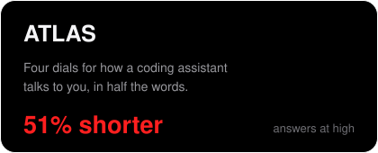
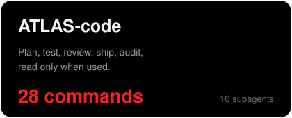
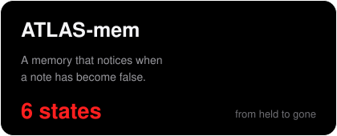
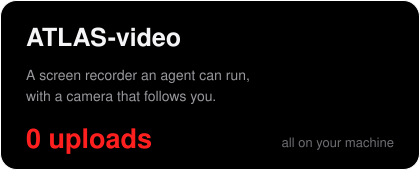
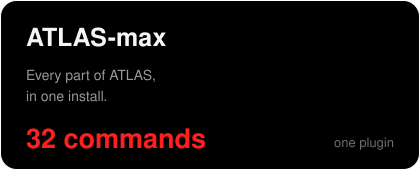
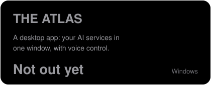
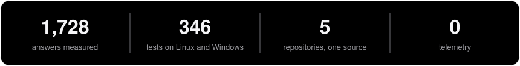

<p align="center"></p>

I'm ZoCCo, from Italy. I build tools for people who work with AI coding agents. Everything I publish carries its own measurements, with the script to rerun them, and says where someone else does it better.

## THE ATLAS

My main project: a family of plugins for Claude Code, and an app.

<p align="center">
<a href="https://github.com/Z0CC0/ATLAS"></a>
<a href="https://github.com/Z0CC0/ATLAS-code"></a>
</p>
<p align="center">
<a href="https://github.com/Z0CC0/ATLAS-mem"></a>
<a href="https://github.com/Z0CC0/ATLAS-video"></a>
</p>
<p align="center">
<a href="https://github.com/Z0CC0/ATLAS-max"></a>

</p>

<p align="center"></p>

## How I build

- **I measure, and I print what I find.** Every figure comes from a bench anyone can rerun, including the ones that make my work look worse.
- **I compare.** Each repository names the projects it learned from and says what they do better.
- **It runs on your machine.** No account, no telemetry, nothing sent unless you ask for it.

## Start here

```
/plugin marketplace add Z0CC0/ATLAS
/plugin install atlas@atlas
```

Then, in any chat: `atlas high`.
